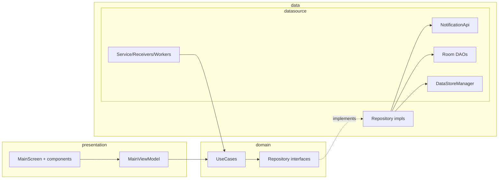

## Исходные наблюдения

- Основной код лежит в `com.android.autopay`.
- `domain/` отсутствует. В `data/` смешаны DataStore, Room, сеть, Service/Receivers/Workers, модели, мапперы, утилиты. `di/` содержит `App.kt` (должен быть вне `di`). `presentation/` почти плоский. В `app/src/main/java/com/android/autopay/app/src/main/java/...MainActivity.kt` лежит осиротевший дубликат `MainActivity.kt` (по `diff` идентичен корневому) — чистый мусор.
- Правило запрещает ломать стек (Compose/Hilt/Room/DataStore/WorkManager/OkHttp), требует инкрементальности и компилируемости каждого шага.

## Целевая структура пакетов

```plaintext
com.android.autopay/
  MainActivity.kt
  App.kt                              # вынесен из di/
  data/
    datasource/
      local/                          # Room: NotificationDatabase, DAO, entities, mappers
      remote/                         # NotificationApi, ApiEndpoints
      preferences/                    # DataStoreManager
      services/                       # PushNotificationHandlerService
      receivers/                      # SmsReceiver, BootBroadcastReceiver
      workers/                        # PingWorker, NotificationRetryWorker
    models/                           # DBO/DTO + мапперы (DBO <-> domain)
    repository/                       # NotificationRepositoryImpl, SettingsRepositoryImpl
  domain/
    models/                           # Notification, NotificationType, SettingsData, Sms, Push
    repository/                       # NotificationRepository, SettingsRepository (interfaces)
    usecases/                         # 6 ключевых use case
  presentation/
    screens/                          # MainScreen (Scaffold, оркестрация)
    components/                       # NotificationView, DeviceInfoRowView, SourceSelectionList, TokenDialog, SourceFiltersDialog
    theme/                            # Color.kt, Theme.kt, Type.kt (из ui/theme)
    viewmodels/                       # MainViewModel, MainContract
  di/
    NetworkModule.kt
    DatabaseModule.kt
    RepositoryModule.kt               # @Binds интерфейс→impl
    DispatchersModule.kt
  utils/                              # SourceFilter, StableId, AppDispatchers, Constants
```

## Ключевые архитектурные решения

- **Android-компоненты** (`Service`, `BroadcastReceiver`, `Worker`) размещаются в `data/datasource/{services,receivers,workers}` как источники системных событий. Они используют домен только через интерфейсы репозиториев и use cases, без утечки Android SDK в domain.
- **domain-слой умеренный**: интерфейсы `NotificationRepository`, `SettingsRepository` + 6 ключевых use case:
  - `ConnectDeviceUseCase`
  - `SendNotificationUseCase` (сохранить в историю, отправить, при сбое — в очередь ретрая)
  - `RetryPendingNotificationsUseCase`
  - `PingServerUseCase`
  - `ObserveNotificationHistoryUseCase` (+ `GetHistoryPageUseCase`)
  - `ToggleAutomationUseCase`
- `MainViewModel` переключается на use cases и `SettingsRepository` (интерфейс). Низкоуровневый `DataStoreManager` используется только через `SettingsRepositoryImpl`.
- **Имя пакета `com.android.autopay` НЕ меняем** (правило использует `com.package` как плейсхолдер). Это безопасно для `namespace`, `applicationId` и сохранённых настроек DataStore у пользователей.
- **App.kt вне `di/`** — это `Application`, а не Hilt-модуль. Перенос в корневой пакет, `AndroidManifest.xml` обновляется (`android:name=".App"`).
- **`AppModule` разбивается по SRP** (SOLID из правил) на `NetworkModule`, `DatabaseModule`, `RepositoryModule` (`@Binds` для интерфейсов), `DispatchersModule`.
- **Модели**: доменные модели (`Notification`, `NotificationType`, `SettingsData`, `Sms`, `Push`) переезжают в `domain/models`. DBO-модели и мапперы остаются в `data/`: `data/datasource/local/entities` + `data/models/mappers`.

## Ход работы (компилируемость каждого этапа)

### Этап 0. Чистка мусорного файла

- Удалить `[app/src/main/java/com/android/autopay/app/src/main/java/com/android/autopay/app/src/main/java/com/android/autopay/app/src/main/java/com/android/autopay/app/src/main/java/com/android/autopay/app/src/main/java/com/android/autopay/app/src/main/java/com/android/autopay/app/src/main/java/com/android/autopay/MainActivity.kt](app/src/main/java/com/android/autopay/app/src/main/java/com/android/autopay/app/src/main/java/com/android/autopay/app/src/main/java/com/android/autopay/app/src/main/java/com/android/autopay/app/src/main/java/com/android/autopay/app/src/main/java/com/android/autopay/app/src/main/java/com/android/autopay/MainActivity.kt) (подтверждено: `diff` с корневым — идентичен, просто случайно созданная вложенная копия).

### Этап 1. Верхнеуровневый `utils/`

- Создать пакет `com.android.autopay.utils`.
- Перенести `SourceFilter`, `StableId`, `AppDispatchers`, `Constants` из `data/utils/` в `utils/`. Удалить `data/utils/`.
- Массово обновить импорты: `com.android.autopay.data.utils.*` → `com.android.autopay.utils.*`.

### Этап 2. Domain-слой

- Создать `domain/models`, перенести туда `Notification`, `NotificationType`, `SettingsData`, `Sms`, `Push` из `data/models/`.
- Создать `domain/repository/NotificationRepository.kt` — интерфейс с текущей публичной поверхностью `NotificationRepository` (connect, sendToServer, saveToHistory, markSentSuccess, observeHistory/Latest/Count/*, getHistoryPage, saveForRetry/getForRetry/deleteForRetry, getDeviceSmsSenders, getInstalledApplicationPackages).
- Создать `domain/repository/SettingsRepository.kt` — интерфейс над `DataStoreManager` (`getSettings()`, `saveSettings`, `saveLastSuccessfulPingAt`, `saveAutomationEnabled`, `saveSelectedSmsSenders/BankApplications`, `addKnownSmsSender/BankApplication`).
- В `data/repository/NotificationRepositoryImpl.kt` и `SettingsRepositoryImpl.kt` — вынести текущие реализации, заставить реализовывать интерфейсы. `DataStoreManager` остаётся как чисто DataStore-обёртка в `data/datasource/preferences/` и используется `SettingsRepositoryImpl`.

### Этап 3. `data/datasource/` (локальные и сетевые источники)

- Переместить:
  - `data/local/db/*` → `data/datasource/local/db/*`
  - `data/local/models/*` → `data/datasource/local/entities/*` (переименовать файлы DBO)
  - `data/local/mappers/*` → `data/models/mappers/*`
  - `data/network/*` → `data/datasource/remote/*`
  - `data/DataStoreManager.kt` → `data/datasource/preferences/DataStoreManager.kt`
- Обновить `package` в каждом файле, импорты во всём проекте.

### Этап 4. Android-компоненты → `data/datasource/`

- Переместить:
  - `data/PushNotificationHandlerService.kt` → `data/datasource/services/PushNotificationHandlerService.kt`
  - `data/SmsReceiver.kt` → `data/datasource/receivers/SmsReceiver.kt`
  - `data/BootBroadcastReceiver.kt` → `data/datasource/receivers/BootBroadcastReceiver.kt`
  - `data/PingWorker.kt` → `data/datasource/workers/PingWorker.kt`
  - `data/NotificationRetryWorker.kt` → `data/datasource/workers/NotificationRetryWorker.kt`
- Обновить `[app/src/main/AndroidManifest.xml](app/src/main/AndroidManifest.xml)`: все `.data.Xxx` → `.data.datasource.<kind>.Xxx`.
- `BootBroadcastReceiver` перевести на `@AndroidEntryPoint` + `@Inject SettingsRepository` вместо ручного `DataStoreManager(context.applicationContext)` и `runBlocking` (соответствует правилам coroutines/Hilt).

### Этап 5. Presentation

- Создать `presentation/theme/` — перенести содержимое `presentation/ui/theme/*`, удалить промежуточный пакет `ui`.
- Создать `presentation/components/` и вынести из `[app/src/main/java/com/android/autopay/presentation/MainScreen.kt](app/src/main/java/com/android/autopay/presentation/MainScreen.kt)`:
  - `NotificationView`, `DeviceInfoRowView`, `MinimalNotificationItem`
  - `SourceSelectionList`
  - `TokenDialog` (AlertDialog смены токена)
  - `SourceFiltersDialog` (AlertDialog выбора источников)
- `MainScreen.kt` → `presentation/screens/MainScreen.kt`; он только собирает `Scaffold` и делегирует в компоненты. Выполнить гайдлайны Compose: упорядочить модификаторы, `remember { mutableStateOf(...) }` только где нужно, `stringResource` для всех пользовательских строк (перенести русские тексты в `[app/src/main/res/values/strings.xml](app/src/main/res/values/strings.xml)` — по необходимости в рамках того же этапа), устранить magic colors через `MaterialTheme.colorScheme`/`extended colors`.
- `MainViewModel.kt` и `MainContract` → `presentation/viewmodels/MainViewModel.kt` и `presentation/viewmodels/MainContract.kt` (разделение файлов).

### Этап 6. DI и `App`

- Переместить `[app/src/main/java/com/android/autopay/di/App.kt](app/src/main/java/com/android/autopay/di/App.kt)` → `app/src/main/java/com/android/autopay/App.kt` (package `com.android.autopay`). Обновить `AndroidManifest.xml` → `android:name=".App"`.
- Разбить `[app/src/main/java/com/android/autopay/di/AppModule.kt](app/src/main/java/com/android/autopay/di/AppModule.kt)`:
  - `NetworkModule` — `provideOkHttpClient`, `provideNotificationApi`.
  - `DatabaseModule` — `provideNotificationDatabase`, `provideUnsentNotificationDao`, `provideNotificationHistoryDao`.
  - `DispatchersModule` — `provideAppDispatchers`.
  - `RepositoryModule` (`@Binds`) — `NotificationRepository` → `Impl`, `SettingsRepository` → `Impl`.

### Этап 7. Use cases и MainViewModel

- Создать в `domain/usecases`: `ConnectDeviceUseCase`, `SendNotificationUseCase`, `RetryPendingNotificationsUseCase`, `PingServerUseCase`, `ObserveNotificationHistoryUseCase`, `ToggleAutomationUseCase`. Каждый — маленький класс с `operator fun invoke(...)` и инъекцией интерфейсов репозиториев.
- `PushNotificationHandlerService`, `SmsReceiver`, воркеры — переключить на соответствующие use cases (напр. `SendNotificationUseCase`, `RetryPendingNotificationsUseCase`, `PingServerUseCase`). Это устраняет дублирование retry-логики между `NotificationRetryWorker` и `PushNotificationHandlerService`.
- `MainViewModel` — принимает use cases и `SettingsRepository` вместо `DataStoreManager` + `NotificationRepository`. Порядок подписок и поведение сохраняем 1:1 (таймер `lastPingElapsedSeconds`, автообновление страниц лога и т.д.).

### Этап 8. Приведение к кодстайлу правил

- Убрать пустые строки внутри функций (правило «Don't leave blank lines within a function») — особенно в `MainActivity.onCreate`, `NotificationApi`, `MainScreen`.
- Удалить narration-комментарии («Ретраи теперь выполняются…», «Удалено планирование…», «Если меняются последние записи…» и т.п.) — оставить только те, что объясняют неочевидные ограничения.
- Заменить magic numbers на именованные `const val` (pageSize, delay 1000, token visible length и т.д.) в нужных местах.
- Привести именование: файлы/директории `underscores_case` там, где осталось верблюжье (Android ограничивает это для манифестных компонентов, поэтому правило трактуем как «новые файлы утилит/моделей/мапперов — с рекомендованным стилем, Android-классы оставляем PascalCase, как требует платформа»).

### Этап 9. Тесты и проверка сборки

- Обновить путь и импорты у существующих `ExampleUnitTest` / `ExampleInstrumentedTest`, добавить один реальный unit-тест для `SendNotificationUseCase` с fake-репозиториями (следуя правилам тестирования: AAA, `inputX/mockX/actualX/expectedX`).
- Финальная сверка: запуск `./gradlew assembleDebug` и `./gradlew testDebugUnitTest` после каждого крупного этапа (минимум этапы 3, 5, 7, 9).

## Файлы, которые будут затронуты (обзорно)

- Переименовываются/перемещаются: все `.kt`-файлы под `app/src/main/java/com/android/autopay/` кроме `MainActivity.kt`.
- Обновляются: `[app/src/main/AndroidManifest.xml](app/src/main/AndroidManifest.xml)` (пути сервис/ресиверов/Application).
- Без изменений: `[app/build.gradle.kts](app/build.gradle.kts)`, `[settings.gradle.kts](settings.gradle.kts)`, `libs.versions.toml`, `AndroidManifest`-декларации прав доступа, `[app/src/main/res/](app/src/main/res/)` (кроме опционального добавления строк).

## Диаграмма итогового потока данных



## Риски и смягчение

- Изменение пути Service/Receivers в манифесте может сломать рантайм до первой установки → применяется атомарно (файлы + манифест в одном этапе 4), сразу верифицируем сборку.
- Хранилище DataStore привязано к имени файла `settings` (в `DataStoreManager.DATASTORE_NAME`) — не меняем.
- `NotificationDatabase` схема и имя — не меняем, Room-миграции не требуются.
- Package имени не трогаем.
- После каждого крупного этапа — прогон сборки, без попытки сделать всё одним коммитом.